<p align="center">
  
</p>

<h1 align="center">🛡️ 破甲 De-Armor — 回答与代码的任务导向校准</h1>

<p align="center"><strong>Version 2.2.0</strong></p>

<p align="center">
  <em>敢说真话：不说谎，不忽悠，不会就说不会，不行就说不行，该做的就做。少一点自保，多一点结果，删掉套话，不能删掉事实。写代码同理：先看再写，项目里有的就复用，只写这次需要的，守住安全底线，没有本轮的运行证据就不说「完成」。</em>
</p>

<p align="center">
  <a href="https://github.com/ninetyhe-90/de-armor/stargazers"></a>
  <a href="https://github.com/ninetyhe-90/de-armor"></a>
  <a href="https://clawhub.ai/skills/de-armor"></a>
  <br>
  
  
  
  
</p>

<p align="center">
  <a href="README.md">English</a> | <a href="README.zh-CN.md">中文</a>
</p>

> **v2 重写了规则。** v1 用禁词分数和 90 分门槛裁决回复，v2 已移除。输出改为 `schema_version: 2`、`stats.score: null`，审查是任务导向的：事实、条件、不确定性、边界有没有保住，用户要的产物有没有交付。`--min-score` 现在会明确报错，不再静默忽略。

> **机检只是第二双眼睛，不是判决。** `armor_lint.py` 通过，只代表本次检查没有丢失声明锚点、没有出现禁用断言。它**不是**事实或语义正确性的认证。

## 目录

- [它是什么](#它是什么)
- [什么时候用](#什么时候用)
- [安装](#安装)
- [预览](#预览)
- [使用](#使用)
- [工作方式](#工作方式)
- [代码路线（至简）](#代码路线至简)
- [本地审查器](#本地审查器)
- [案例与实验台](#案例与实验台)
- [目录结构](#目录结构)
- [边界](#边界)
- [更新日志](#更新日志)

---

## 它是什么

AI 的回答经常以一种很具体的方式失效：它被优化成「看起来很谨慎」，而不是「真的有用」。先免责、再铺垫、把查资料的工作退回用户、用「各有优劣」代替选择、把不确定说成确定——或者反过来，把一句有用的话压成一句空话。

**破甲（de-armor）** 是一份任务导向的校准技能，管 AI 的两类产物：**回答**和**代码**。它以可移植的 `SKILL.md` 分发，不绑定任何单一 agent 或平台。

处理回答时，它先锁定任务和不可丢失的信息，再从任务重写，而不是从禁词表重写。事实、条件、否定、不确定性和权限边界留下；重复、身份前置和空对冲删掉。

处理代码时，它把一条有顺序的短流程放在每次改动前面：先摸清仓库结构、先搜复用、只写这次需要的、守住安全底线，并且要有本轮的运行证据才说「完成」。原 **de-bloat 至简** 技能现在就是这条代码路线，它的规则、语言参考和评估用例都并入本仓库。

| 你会得到 | 它做什么 |
|---|---|
| **任务定位** | 把真实需求——答案、选择、成品、排查动作或情绪支持——从表面礼貌里分出来 |
| **信息账本** | 保住事实、条件、不确定性、边界和本轮该交付的产物 |
| **任务优先改写** | 保留、压缩、重排、补齐；不为显得具体而编造事实 |
| **结构速览与先找复用** | 写码前给出带路径的 5 行结构图，全仓库搜复用，每新建一个符号都要有理由 |
| **有依据才抽象** | 只有已存在的真实调用方才提取或参数化；偶然重复保持独立 |
| **节俭实现与安全底线** | YAGNI、不静默兜底、精准 diff，六条安全规则在边界校验一次 |
| **可选审查器** | 只读、离线的 Python 检查器，核对事实锚点、约束遗漏和新增数字 |
| **可复现案例** | 6 个回答场景，加 8 个代码行为用例，全部带可判定断言 |

它不是「请简洁一点」提示词。短不是目标，交付才是。真实拒绝可以是对的答案，长回答也可以是对的答案，小 diff 也可能改错地方。

---

## 什么时候用

- 有能力完成，却只给免责声明或把工作退回用户。
- 用户要推荐，却只列优缺点，不给有条件的选择。
- 非关键参数缺失，就连问一串问题，不给能先用的草案。
- 看似简短直接，实则丢掉条件、否定、不确定性或真实风险。
- 已写好长回复，需要保留实质内容并压掉社交填充。

代码任务：

- 任何会产生或修改代码的任务：新功能、加接口、重构、修 bug、写脚本。
- 用户说「简单点」「别过度设计」「复用已有的」「抽一下公共方法」「按官方规范写」。
- 代码里出现重复造轮子、复制粘贴的相似代码、层层 try/catch、空兜底，或者为了一个从没到来的未来而建的抽象。

正常的简短回答直接交付，不必强行改写；单文件、几行、不新增函数的小改动走代码路线简版。用户只说「破甲」时，修复上一条回答，不先讲技能介绍。

---

## 安装

破甲是一份可移植的 `SKILL.md` 加上可选的 `references/` 和 `scripts/`。里面没有任何东西绑定某个产品：没有 SDK、没有运行时、没有配置文件、没有厂商 API。任何能读技能文件或系统提示的 agent 都能用。

```sh
# 从 ClawHub 安装
clawhub install de-armor

# 或克隆后自行接入
git clone https://github.com/ninetyhe-90/de-armor.git
```

然后按你的 agent 原本加载技能的方式接入：

- **有技能目录的 agent**——把整个目录放进去即可；目录结构是约定，不是硬性要求。
- **靠规则/指令驱动的 agent**——把 `SKILL.md` 贴进它的规则文件、`AGENTS.md` 或系统提示。
- **没有技能机制**——把 `SKILL.md` 前置到对话上下文。

核心流程只依赖 `SKILL.md`。审查器是可选的，只用 Python 3.9+ 标准库，不需要第三方包。

## 预览

<p align="center">
  
</p>

`assets/de-armor-demo.html` 是可离线打开的交互实验台，和脚本读取同一份 `assets/cases.json`。不需要 API key，不上传任何内容。

| 改前 / 改后对比 | 机器审查 |
|---|---|
|  |  |

| 保留边界 | 反例拦截 |
|---|---|
|  |  |

---

## 使用

技能由自然语言触发。常见说法：

```text
破甲
说人话，别绕
别给我一堆免责声明，直接给方案
审一下这段回复，保留事实和条件
```

用户没给额外内容时，技能修复上一条回答，不先输出一篇方法论。

---

## 工作方式

1. **定位实际任务**——要答案、要选择、要成品、要排查动作，还是要情绪支持。
2. **锁定不可丢失的信息**——事实、条件、不确定性、权限边界、本轮产物。
3. **从任务重写**——保留、压缩、重排、补齐。新推断显式标注；缺证据就核实，不编造。
4. **核对后交付**——事实与约束 → 任务完成度 → 表达负担。只对发现的问题再改一轮。

三条硬约束：

- 不把未知改成确定。
- 不把未执行写成已验证。
- 不为减少拒绝而扩大权限。

「可能」「建议」「抱歉」「不能」都**不是**禁词。删掉它们会改变置信度、权限或风险时，就保留。

<details>
<summary><strong>信息合同（v2）</strong></summary>

长文或明确要求审计时，可以用 JSON 合同核对：

```json
{
  "schema_version": 2,
  "required": [
    {
      "id": "status",
      "kind": "fact",
      "label": "观测到状态码 504",
      "source": "网关返回 504",
      "any_of": ["504"]
    },
    {
      "id": "unknown",
      "kind": "uncertainty",
      "label": "根因仍不能确定",
      "source": "没有完整链路，不能确定根因",
      "any_of": ["不能确定根因"]
    }
  ],
  "forbidden": ["根因就是数据库", "已经验证根因"]
}
```

`BLOCKED`：缺少声明锚点或出现禁用断言。`REVIEW`：发现措辞或新增数字提示，或未提供信息合同。`CHECKED`：本次机器检查未发现问题——仍不是语义认证。

</details>

---

## 代码路线（至简）

<p align="center">
  
</p>

代码路线就是原来的 **de-bloat 至简**，现在作为破甲的第二条路线并入。它适用于任何会产生或修改代码的任务，覆盖 C++、Go、Java、Python、Node.js；自包含，只描述动作、不绑定工具：列目录、搜文本、搜文件名，可选地把大范围搜索交给子代理。

1. **结构速览与目标**——先给 5 行结构图（构建文件、分层、公共代码、惯例、测试，每行都有路径为证），读改动涉及的调用方，把需求改写成可验证的成功标准。写明关键假设，只有影响正确性的问题才问。
2. **先找复用**——搜整个仓库，不只看打开的文件。记下每个候选的路径、能力和改造成本，然后三选一：直接复用 / 小改造复用 / 确实没有才新建（新建要说明理由）。
3. **节俭实现**——YAGNI。缺失值代表异常就直接报错。底层支持批量就一次调用。diff 的每一行都能追溯到需求；无关格式和原有的死代码不动。
4. **根因与抽象**——修 bug：先复现，追到坏值源头，先写失败的测试，试了 3 种修法仍失败就停下。处理重复：只按已经存在的调用方决定是否抽象。
5. **安全底线与证据**——六条硬规则在边界校验一次，内部不重复堆防御。运行能证明结论的命令，读完输出再报告；跑不了就写明哪些没验证、为什么。

要不要抽象，依据是现在已经存在的调用方，不是未来。

| 复用搜索发现的情况 | 做法 |
|---|---|
| 已有一份语义相同的实现，这次要写第二份 | 提取成一个函数，放到最近的公共模块，原来的调用方也改成调用它 |
| 已有 2 处以上只差少数值的相似代码 | 合并成一个函数，参数只覆盖已经出现过的差异 |
| 现成函数差一点就够用 | 在原函数上小改 |
| 只有一个实现或一个调用方 | 不建接口、基类、工厂、策略 |
| 长得像，但会因为不同原因各自变化 | 不合并，合并会把两个领域绑在一起 |
| 理由是「以后可能用」 | 不抽象 |

技能会按每个改动文件的语言只加载对应参考。优先级从高到低：语言强制工具（`gofmt`）> 项目自己的规范配置（`.clang-format`、Checkstyle、Ruff、ESLint、Prettier、`.editorconfig`）> 官方规范 > 项目声明的语言版本。规范只作用于本次改动的代码。

| 语言 | 官方来源 | 参考文件 |
|---|---|---|
| C++ | ISO C++ Core Guidelines | `references/code/lang/cpp.md` |
| Go | `gofmt`、Effective Go、Go Code Review Comments | `references/code/lang/go.md` |
| Java | Oracle Code Conventions、Javadoc 写作指南 | `references/code/lang/java.md` |
| Python | PEP 8、PEP 257、PEP 484 | `references/code/lang/python.md` |
| Node.js | Node.js 官方 API 文档与 Learn 指南 | `references/code/lang/nodejs.md` |

<p align="center">
  
</p>

这张图是按代码评估用例 1 的期望行为画的示意图，**不是模型的真实输出记录**。测试项目里已经有 `src/utils/date.js:formatDate`；膨胀写法另写了一个格式化函数：带一个没用的参数、静默返回空字符串、吞掉异常，还悄悄把 UTC 改成本地时间。至简写法是两行 diff，复用现有函数，并贴出实际运行的输出。

`evals/code/evals.json` 有 8 个带客观断言的行为用例（复用、不静默兜底、按根因修 bug、精准修改、安全底线不过度防御、官方规范、提取公共逻辑、保留偶然重复）。`evals/code/trigger_evals.json` 有 22 条触发测试，覆盖两条路线及容易混淆但不该触发的问法。仓库不附带运行器：每个用例在测试项目的干净副本上各跑一次「加载 skill」和「不加载」，再按 diff 和回复逐条判定断言。

---

## 本地审查器

`scripts/armor_lint.py` 只读、离线，不生成回答、不改文本、不联网。引用、围栏代码和行内代码不按日常措辞计入。

```sh
# 普通审查
python3 scripts/armor_lint.py draft.txt --json

# 合同审查：对照基线，核对锚点、禁用断言与新增数字
python3 scripts/armor_lint.py revised.txt \
  --baseline draft.txt --contract contract.json --json

# 修改 cases.json 后刷新展示页内的审核结果
python3 -B scripts/build_demo.py --write
```

文本可用 `-` 从标准输入传入。

| 结果 | 含义 |
|---|---|
| `BLOCKED` | 缺少声明锚点或出现禁用断言 |
| `REVIEW` | 措辞或新增数字提示，或未提供信息合同 |
| `CHECKED` | 本次机器检查未发现问题——**不是**正确性认证 |

退出码：`0` 无机器阻断（仍需人工核对）；`1` 合同阻断；`2` 输入错误。

---

## 案例与实验台

`assets/cases.json` 是 6 个场景的唯一数据源。每个案例都带改前/改后、过度压缩的反例和信息合同；展示页中的审核结果都由这个文件算出。

| 案例 | 标签 | 它展示什么 |
|---|---|---|
| 故障排查 | `DIAGNOSE` | 先给动作，根因仍未确定 |
| 生产变更 | `PRESERVE` | 风险要具体，但不编锁表时长 |
| 技术选型 | `DECIDE` | 给有条件的选择，不是优缺点清单 |
| 先交草案 | `DELIVER` | 交一版能用的，不再多问一轮 |
| 诚实边界 | `BE HONEST` | 说清做不到的，做完能做的 |
| 保留人味 | `STAY HUMAN` | 删社交填充，不删有效共情 |

展示页和截图使用同一份数据，所有规则结果都由随附脚本在本地计算。

---

## 目录结构

```text
de-armor/
├── SKILL.md                     # 技能入口
├── README.md                    # 英文 README
├── README.zh-CN.md              # 中文 README
├── _meta.json                   # 本地分发元数据
├── docs/
│   ├── banner.svg               # README 横幅
│   └── code/                    # 代码路线配图
├── assets/
│   ├── cases.json               # 回答案例唯一数据源
│   ├── de-armor-demo.html       # 离线交互实验台
│   └── screenshots/             # 实际浏览器截图
├── references/
│   ├── theory.md                # 回答路线：方法与取舍
│   ├── armor-patterns.md        # 回答路线：检测协议与局限
│   ├── overcorrection.md        # 回答路线：过度压缩反例
│   ├── rewrite-examples.md      # 回答路线：场景练习与复跑方法
│   ├── system-prompt.md         # 精简版，可直接放进系统提示词
│   └── code/
│       ├── workflow.md          # 代码路线：完整流程与交付清单
│       ├── reuse-discovery.md   # 复用搜索策略与判定标准
│       ├── over-defense-patterns.md
│       ├── security-floor.md    # 安全底线与信任边界
│       └── lang/                # cpp.md go.md java.md python.md nodejs.md
├── evals/
│   └── code/                    # 8 个行为用例、22 条触发测试与测试项目
└── scripts/
    ├── armor_lint.py            # 只读审查器
    └── build_demo.py            # 重算展示页内的审核结果
```

---

## 边界

- 机检通过不等于事实正确；语义仍需人工判断。
- 不覆盖宿主指令、授权与真实安全限制；不用于绕过权限。
- 不联网、不上传数据、不自动改写文本。
- 宿主真实边界、用户格式需求和必要工作流程不因本技能改变。
- 代码路线是一组指令，不是强制机制；8 个行为用例的「加载 / 不加载」对比还没跑，也没有公开结果。
- 排版上项目配置优先于官方语言规范；与本技能的「安全底线」「YAGNI」冲突时，以后者为准。

---

## 更新日志

- **2.2.0** — **de-bloat 并入为代码路线。** 技能现在同时处理回答和代码。新增 `references/code/`，包含完整的有序流程、复用发现、过度防御模式、安全底线，以及 C++/Go/Java/Python/Node.js 参考；8 个行为用例、测试项目，以及扩展到 22 条的触发测试移到 `evals/code/`。`SKILL.md` 新增路线分诊、精简版代码流程和两条路线共用的不变量；回答路线与审查器行为不变。版本号和 README 同步更新为合并后的范围。
- **2.1.0** — 检测面扩展：新增 A06 识别“各有优劣 / 需综合考虑”式假中立，写明触发条件的选择不受影响；新增 E01–E05 英文基础模式（身份前置、通用免责、赞美填充、假中立、答案延后），全部为提示级。合同锚点匹配前做全角与大小写归一化；C03 不再把有序列表编号和“第 N 步”当作新增数字。
- **2.1.1** — 合同检查更严格、更难绕过。缺失锚点一律阻断，并附最接近的候选原句供人工核对，说反的句子（如把“不能确定根因”写成“已经确定根因”）不会被放宽。归一化保留句末标点和 ASCII 词间空格，所以不会跨句拼接，`v1 2` 也不会匹配 `v1.2`；同时折叠 Markdown 强调、引号和软换行。禁用断言走同一套归一化，全角、大小写、折行、加粗都不能绕过。C03 不再把全角数字当作新增数字。
- **2.1.2** — 禁用断言区分“引用”和“断言”。断言只出现在成对引号、行内代码、围栏代码或块引用内时降为提示级，因此“这句话不成立”“文档里夹了一句指令，我没有照做”这类纠正与转述不再被阻断；只要正文里有一处裸露出现，或断言只有一部分在引号内，仍然阻断。
- **2.0.3** — 仅文档：安装说明完全平台无关——不写具体产品路径、不点名厂商，按你的 agent 原有方式加载 `SKILL.md` 即可。行为无变化。
- **2.0.2** — README 重做为居中、徽章优先的双语版本，并加入自定义横幅。行为无变化。
- **2.0.1** — 新增中英双语 README。
- **2.0.0** — 任务导向重写。移除禁词打分和 90 分门槛；新增 `schema_version: 2`、信息合同、新增数字检查、6 个可复现案例和离线实验台。
- **1.x** — 旧的 hard/soft/style 规则集与 `render` API，v2 已移除。
